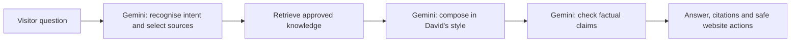

# David's interview agent

A Gemini-backed résumé assistant orchestrated with **LangGraph JS**. The portfolio stays on GitHub Pages; a Cloudflare Worker holds the API key and serves the chat endpoint.

## How an answer is produced



The graph is compiled once per knowledge version. Per-request credentials, progress callbacks and conversation state stay separate. Greeting/navigation responses may skip the factual review node. There is no keyword-to-answer table. Suggested starter questions are UI prompts, not canned answers.

The approved material includes the Chinese résumé, confirmed corrections, public project descriptions, selected implementation summaries, and David's own interview answers. Implementation observations do not establish personal authorship. Missing grades, metrics or anecdotes must remain unknown. Model review reduces errors but does not guarantee correctness; important claims should be checked against the linked sources.

## Local setup

Use Node 22.14 or later. From this directory:

```sh
npm ci
npm run dev
```

Open `http://127.0.0.1:8787/owner` to enter a Gemini key and confirm the Google project has **Free Tier with billing unlinked**. The setup accepts both standard and authorization keys as opaque credentials and validates them with Google. It never returns a key to the browser. `.dev.vars` and local authorization files are ignored by Git.

Open `http://127.0.0.1:8787/` to test the portfolio and assistant together. The owner page only exists on the loopback development server; it is not an endpoint on the public Worker.

## Teaching it David's voice

Answer one of the questions on `/owner`, let Gemini prepare a factual summary, edit it, and explicitly approve it for public use. Approval updates `content/knowledge.json` and `content/persona.json`. Local preview reads those files immediately; run a new backend deployment to update the public assistant.

This is grounded retrieval and approved few-shot style conditioning, **not fine-tuning Gemini's model weights**. Visitor messages never become owner facts or training examples automatically. Review source changes before committing them: approved notes are intended to be public.

## Deploy

The backend uses `wrangler.jsonc`. Keep the Worker on Cloudflare's Free plan and the Google project on its free tier. The free-only model allowlist is in `src/model.mjs`; there is no paid fallback. Provider quotas and availability may change or temporarily limit replies.

```sh
npx wrangler login --scopes account:read user:read workers_scripts:write d1:write
npx wrangler d1 execute david-agent-quotas --remote --file=schema.sql
npx wrangler deploy
npx wrangler secret put GEMINI_API_KEY
```

The database binding must refer to your D1 database. Enter the key at the secret prompt; never put it in command arguments, source files, the portfolio config, or a commit. Set `FREE_TIER_CONFIRMED` to `1` only after confirming an unbilled Google project. Set the public Worker URL in the root `agent-config.js`, then publish the static site through GitHub Pages.

This workstation keeps Wrangler's state under ignored `.local/cloudflare` by setting `XDG_CONFIG_HOME` to that absolute directory when running Wrangler. Use the same location for later commands to reuse its authorized account. `WRANGLER_SEND_METRICS=false` disables CLI telemetry.

## Limits and privacy

- CORS permits the configured portfolio origin. This is a browser boundary, not user authentication.
- D1 atomically limits the whole site to 60 chat attempts per UTC day and each IP-derived bucket to 8 attempts per 10 minutes. Requests fail closed if the quota database is missing.
- The database stores counters and daily hashes, not raw IPs, questions or transcripts. Old counters expire after about one day.
- Visitor conversation context is kept in page memory and sent to Gemini for a reply. Reloading/new chat discards it. This service does not write conversation logs. Google processes the messages under its API terms, and free-tier data may be used to improve Google products; the chat UI discloses this.
- Each answer has bounded input, output and history, at most three logical model calls, and at most one retry for a temporary 5xx failure (four HTTP requests total). Quota and authentication failures are not retried. Missing configuration, exhausted quota and model errors show a clear availability message with project/résumé links, not a fabricated answer.
- Source links and website actions come from allowlists; model output is displayed as text, never executed as HTML or code.

## Verification

```sh
npm test
npm run check
npm run build
npm run evaluate
```

Unit tests exercise the actual LangGraph flow with an isolated provider fixture, grounding failure, source and action validation, input limits, origin restrictions, streaming boundaries and credential handling. The evaluation command makes real Gemini requests and writes responses only to ignored `.local/evaluation.json` for human review. Individual cases can be selected, for example `npm run evaluate -- database-followup robot-technical`.
